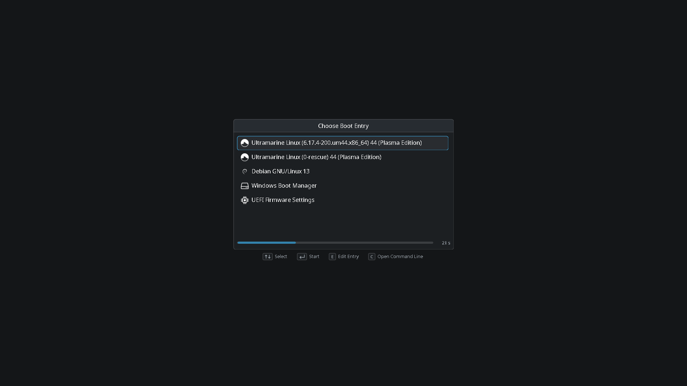
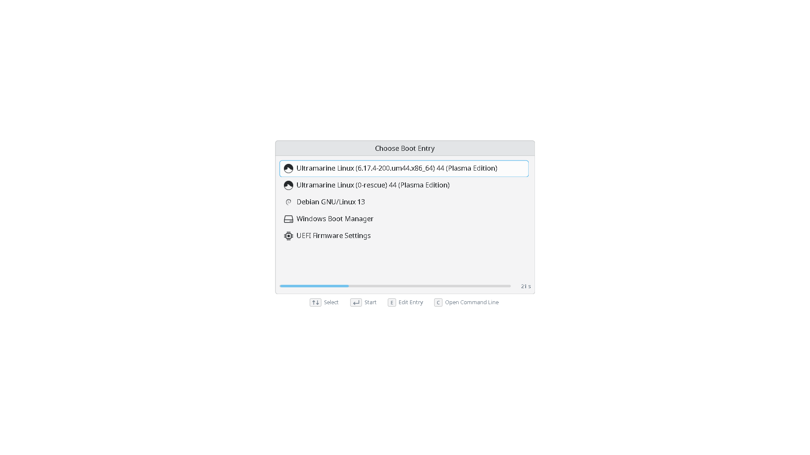
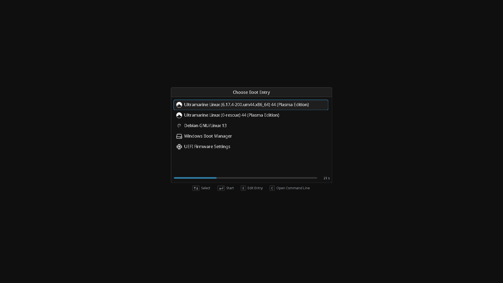

# grub-theme
KDE Breeze style GRUB theme for Ultramarine Linux

**Breeze Dark**: `themes/breeze-dark`. Colours from KDE's Breeze Dark colour scheme.

**Breeze Light**: `themes/breeze-light`. Colours from KDE's Breeze Light colour scheme.

**Breeze Darker**: `themes/breeze-darker`. Colours from
[Xela Breeze Darker](https://github.com/xefensor/xela-breeze-darker) by xefensor.

## ToDo
- [x] Add different modes
  - [x] breeze-light
  - [x] breeze-dark
  - [x] [breeze-darker](https://github.com/xefensor/xela-breeze-darker) (default um theme in upcoming releases?)
- [ ] Package in Terra
- [ ] Switch to reuse licensing
