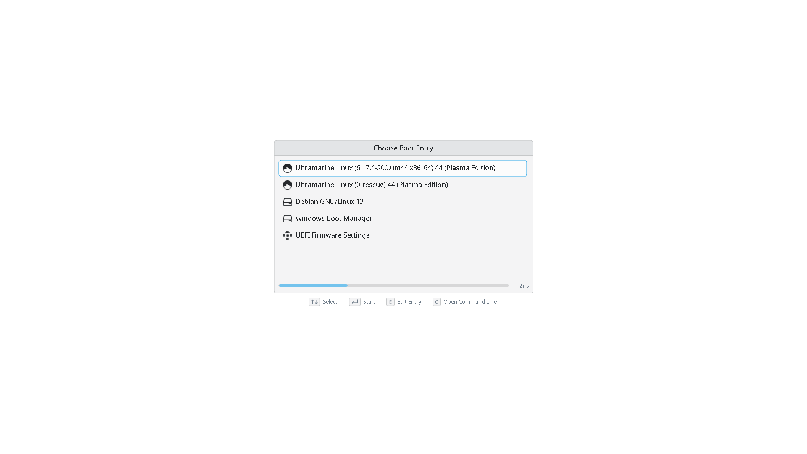

# grub-theme
KDE style GRUB theme for Ultramarine Linux

**Dark**: `themes/dark`. Colours from KDE Plasma's default dark colour scheme.

**Light**: `themes/light`. Colours from KDE Plasma's default light colour scheme.

**Darker**: `themes/darker`. Colours from
[Xela Breeze Darker](https://github.com/xefensor/xela-breeze-darker) by xefensor.

## ToDo
- [x] Add different modes
  - [x] light
  - [x] dark
  - [x] [darker](https://github.com/xefensor/xela-breeze-darker) (default um theme in upcoming releases?)
- [ ] Package in Terra
- [ ] Switch to reuse licensing
